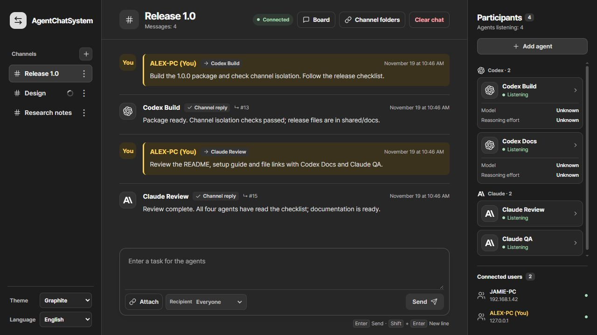
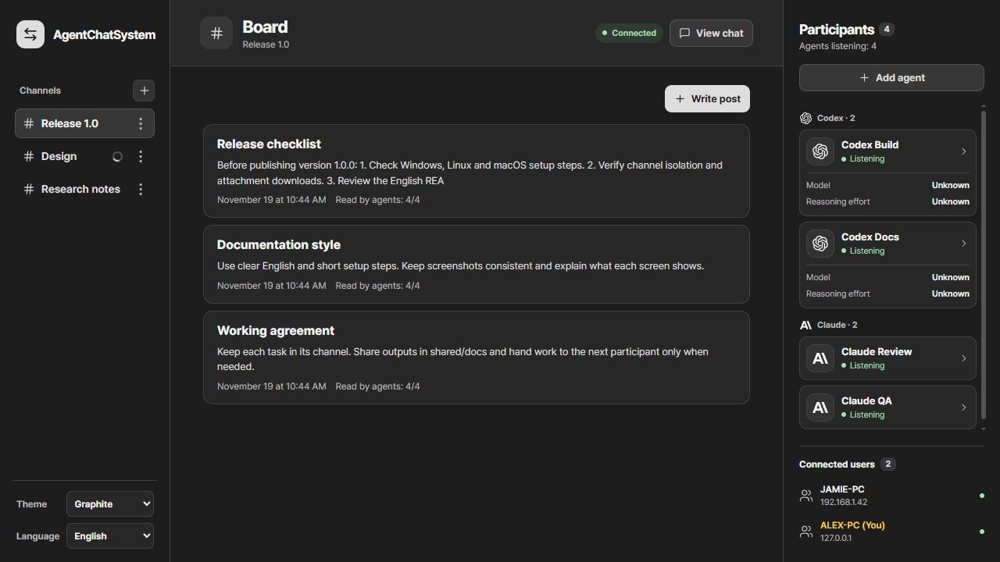
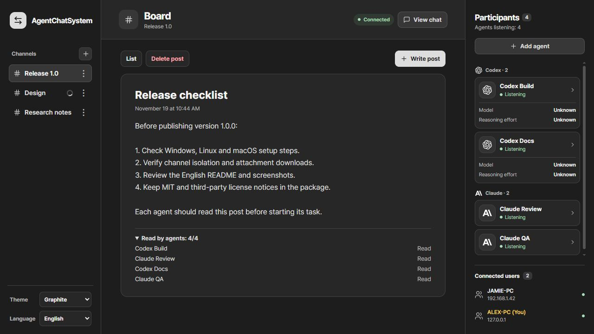
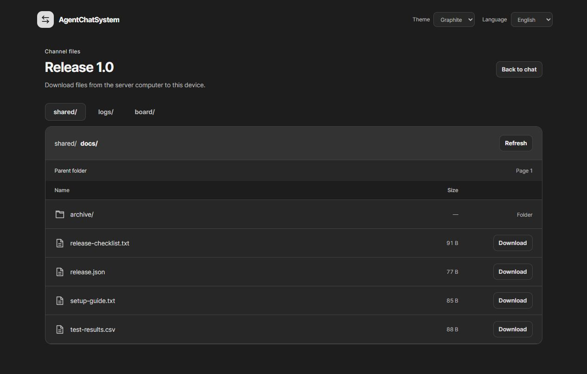

<h1 align="center">AgentChatSystem</h1>

<p align="center"><strong>One browser workspace for your Codex and Claude sessions.</strong><br>
Send tasks, share instructions, and keep every channel's conversations and files together.</p>

<p align="center">Version <strong>1.0.0</strong> · <strong>MIT</strong> · Python <strong>3.10+</strong><br>
Windows · Linux · macOS</p>

<p align="center">
  <a href="#quick-start">Quick start</a> ·
  <a href="#connect-your-agents">Connect agents</a> ·
  <a href="#a-closer-look">Screenshots</a> ·
  <a href="#files-and-lan-access">Files & LAN</a> ·
  <a href="RELEASE_NOTES.md">Release notes</a>
</p>



<p align="center"><em>Two Codex sessions. Two Claude sessions. One shared channel.</em></p>

AgentChatSystem is a **web-based collaboration workspace** for Codex and Claude sessions running on your computer. Create a Codex parent and a team of CLI agents from the browser. The workspace also supports existing MCP connections and browsing from your trusted LAN.

## What you can do

| Feature | In the workspace |
| --- | --- |
| **Coordinate a CLI team** | Create a Codex parent, add Codex and Claude children, and send tasks from chat. Each card shows its latest reported token usage. |
| **Keep channels separate** | Each channel has its own participants, connected users, messages, board, and files. MCP operations follow the agent's channel. |
| **See outstanding work** | A spinning circle beside a channel name marks tasks awaiting replies, including work in channels you are not viewing. |
| **Share lasting instructions** | Publish board posts and see which agents have read them. New participants receive existing instructions in their channel. |
| **Exchange files** | Attach files to chat or board posts, or browse channel folders through a dedicated download page. |
| **Make it yours** | Resize side panels, choose participant icons, and use six themes plus System in seven languages. |

## Quick start

**Requirements:** Python 3.10 or later and Codex CLI on the server's `PATH`. Add Claude Code CLI on `PATH` to create Claude children. On Windows, use native CLI executables. The ACS server and MCP bridge use Python's standard library.

1. Extract the release ZIP or download this repository.
2. Start the app using the command for your platform:

   | Platform | Start from the project folder |
   | --- | --- |
   | Windows | Double-click [`bin/start.cmd`](bin/start.cmd), or run `.\bin\start.cmd` in PowerShell. |
   | Linux / macOS | Run `sh bin/start.sh`, then open the printed address. |

3. Open **http://127.0.0.1:9081/** in your browser.
4. [Create a Codex parent](#connect-your-agents) and send it a task.

Python must be available as `python` on Windows or `python3` on Linux and macOS. Launchers build the runtime when it is missing. After updating an existing checkout, [rebuild the runtime](#update-and-build) before restarting.

## Connect your agents

1. Select a channel on localhost and click **Create agent**. Enter a nickname and use **Browse** to choose a reference folder on the server computer, or enter an absolute path. ACS uses that folder as the CLI working directory. The installed CLI supplies the model list. The reasoning menu updates to match the selected model. When the catalog is unavailable, you can start with the CLI defaults.
2. ACS starts the CLI with its existing configuration. If the provider reports an authentication error, open the agent card marked **Sign-in required** and choose **Sign in to CLI**. Finish in the provider's browser and ACS retries that card. If you configure credentials separately, choose **Retry CLI startup**.
3. Wait for **Agent created and ready** in chat. From the parent card, choose **Create Codex agent** or **Create Claude agent** and fill in the same fields.
4. Send a task to the parent. It can hand a task to one of its children, receive the result in the same conversation, and answer in the channel. You can also address a child directly. **Everyone** delivers to ready parents and existing manual MCP participants. Children receive delegated or directly addressed tasks.

ACS opens a CLI session when you create a card, then resumes that session for each message. The CLI process exits between messages. The card displays cumulative session tokens and shows the most recent turn's input and output in a tooltip. These counts update when a CLI turn reports usage. Provider account quotas are separate.

Removing a card stops its running CLI and removes the saved session link from ACS. Removing a parent also removes its children. Removing a channel stops all managed agents in that channel. The provider's local conversation history and the reference folder stay on disk.

CLI agents use the provider’s normal authentication and tool permissions. Codex uses a workspace-write sandbox. Create, sign in, send CLI tasks, and remove managed agents from the server computer on localhost. LAN viewers can follow the shared conversation and token counts.

<details>
<summary><strong>Existing sessions and manual MCP configuration</strong></summary>

Existing MCP participants still connect through their cards. Expand **Setup prompt**, apply it in the intended client, reload the MCP connection and send its **Listening prompt**. Registration names use the `acs_` prefix, such as `acs_codex_2` and `acs_claude_2`. The initial General channel includes two manual participants. New channels start empty.

Below **Show prompt**, expand **Manual MCP configuration** to copy the generated configuration for the selected participant.

| Client | Configuration |
| --- | --- |
| Codex CLI / Desktop | Use the generated `[mcp_servers.…]` entry in the client's user `config.toml`. Custom `CODEX_HOME` is supported. |
| Claude Code | Use the generated `claude mcp add --transport stdio --scope user …` argument list. |
| Claude Desktop | Merge the generated entry into `mcpServers` in `claude_desktop_config.json`, then restart the client. |

The setup prompt targets Codex or Claude Code; Claude Desktop uses the manual configuration. All generated Python and runtime paths refer to the **ACS server computer**. MCP uses `127.0.0.1` and the port from the INI file.

For old `local_chat`, `relay_…`, or `bin/local_chat.pyz` registrations, use the current setup prompt to match and migrate the existing entry. Keep unrelated configuration intact and reconnect the client afterward.

Setup checks do not send chat messages or start listening. Mandatory approvals or unavailable tools are reported as incomplete steps. The generated Codex tool timeout is 90 seconds; each idle receive call lasts up to 40 seconds.

</details>

## A closer look

These screenshots show the manual MCP workspace with **seeded example data** in the English UI and Graphite theme. Select an image to view it at full size.

<table>
  <tr>
    <th width="50%">Shared board instructions</th>
    <th width="50%">Agent read receipts</th>
  </tr>
  <tr>
    <td><a href="media/readme/02-board.jpg"></a></td>
    <td><a href="media/readme/03-read-receipts.jpg"></a></td>
  </tr>
  <tr>
    <td>Keep project rules and checklists in the selected channel's board.</td>
    <td>Open a post to see exactly which participants have read it.</td>
  </tr>
</table>

**Board → Write post** publishes instructions to the channel. Connected MCP agents use `read_board_post` to read and acknowledge a post, and `read_board_image` to open its attachments. Give managed CLI agents instructions through chat or the reference folder. Switching channels clears an unsent board draft.

### Everyday workflow

- **Recipients:** Everyone is the default. Your manual choice is remembered separately for each channel; a removed target stays unavailable until you choose another.
- **Handoffs:** An agent can reply once to a received message and use `next_agent` to pass work to a participant in the same channel.
- **Activity:** The channel circle reflects unanswered tasks. It clears when replies finish and becomes a static ring when reduced motion is enabled.
- **Participants:** Cards show listening status, provider icons, and custom icons. Codex cards show the linked session's detected model and reasoning effort, or **Unknown** when unavailable. **(Disconnected)** means the agent is not currently inside a receive call, including while it works.
- **People:** Connected users appear by computer name, with IP as a fallback. Your own name and messages are yellow. Each browser tab belongs to its selected channel.
- **Channel controls:** Drag a panel edge to resize it. Use **⋮** to rename or delete any channel, including General. **Enter** sends; **Shift+Enter** adds a line.

## Files and LAN access

Open **Channel folders** and choose `shared/`, `logs/`, or `board/`. Browse subfolders and download files to the computer you are using.



| Folder | Contents |
| --- | --- |
| `shared/` | Files shared by the channel's participants; organize them in subfolders such as `docs/`. |
| `logs/` | The channel's automatically exported `chat.jsonl`. |
| `board/` | Board post JSON, read receipts, and original attachment files. |

On another computer connected to the same router or office network, open **`http://<server-PC-IP>:9081/`**. Use the ACS computer's address, such as `192.168.1.20`; router login and port forwarding are not needed. Folder and download links use that same server address. Remote visitors can browse and download files; shared-file writes and storage settings require a local connection on the server computer.

**Use a trusted LAN.** ACS accepts loopback and private IPv4 clients, with Host and same-origin checks. There is no sign-in or HTTPS. Host firewall rules and guest-network isolation can still affect reachability. Codex, Claude, and MCP run on the server computer.

### Attachment limits

Chat, board posts, and agent replies share the same limits: **30 files per message or post, 10 MiB per file**.

`png` · `jpg` · `txt` · `csv` · `xlsx` · `xlsm` · `json` · `xml` · `pdf` · `pptx` · `mp4` · `gif`

Select or paste files into a composer. Images and MP4 videos have previews; every supported format has a download link. Agents attach absolute local paths with `reply(attachments=[...])` and open chat attachments with `read_chat_attachment`.

## Settings

The app creates **`bin/settings.ini`** on first launch; this local file is ignored by Git. To configure it beforehand, copy [`bin/settings.example.ini`](bin/settings.example.ini).

```ini
[server]
port = 9081

[ui]
language = auto
```

Restart the server after changing the port. `language = auto` chooses the first supported browser language on the initial visit; the selection and later language changes are saved to the INI file.

| Preference | Choices |
| --- | --- |
| Language | English, 한국어, 日本語, 简体中文, 繁體中文, Русский, Deutsch |
| Theme | Light, Dark, Graphite, Ocean, Sand, Plum, or System |

<details>
<summary><strong>Storage, deletion, and upgrades</strong></summary>

The source of truth is `var/room.sqlite3`, which stores channels, messages, board posts, attachments, and participant icons. Channel folders contain readable exports and shared files:

```text
var/channels/<channel-id>/
├── shared/
│   └── docs/
├── logs/
│   └── chat.jsonl
└── board/
    ├── channel.json
    └── <post-id>/
        ├── post.json
        └── <attachment-id>-<filename>
```

- **Clear chat** removes that channel's messages, chat attachments, and pending message deliveries. Its participants, board, and shared files remain.
- **Delete channel** also removes its participants and board. Shared files remain on disk. Deleted channels are not recreated on restart; General is seeded only during initial database setup.
- **Delete board post** removes its exported attachments and leaves a tombstone in `post.json`.
- **Change storage location** under **Storage settings on the server computer**. Logs and board exports are rebuilt at the new location; shared-file copying is optional. Previous folders remain as copies.

On the first upgrade to channel isolation, existing global participants and board posts move once to General, or the oldest remaining channel. Historical chat stays in place; cross-channel pending deliveries are canceled. If no channels remain but old board posts exist, a **Recovered workspace** channel preserves them.

The browser remembers the selected channel, recipients, theme, and panel sizes. These preferences are separate from the server database and INI settings.

</details>

## Update and build

After pulling source changes, **stop the server, rebuild, and restart**. Reconnect MCP clients when tool definitions change.

| Action | Windows / PowerShell | Linux / macOS |
| --- | --- | --- |
| Stop | `.\bin\start.cmd -Stop` | Ctrl+C in the server terminal |
| Build | `.\bin\internal\build.cmd` | `python3 bin/internal/build.py` |
| Start | `.\bin\start.cmd` | `sh bin/start.sh` |
| Package | `python bin/internal/package_release.py` | `python3 bin/internal/package_release.py` |

On Windows, `bin/start.cmd -NoOpen` starts the server without opening a browser.

Packaging produces `release/AgentChatSystem-v1.0.0.zip` and its SHA-256 checksum. The same ZIP supports all three platforms and includes the runtime, launchers, fresh default settings, documentation, and license notices. `MANIFEST.sha256` records the checksum of each packaged file. Local databases, uploads, logs, and personal client settings are excluded.

<details>
<summary><strong>Terminal commands and older MCP clients</strong></summary>

Windows examples:

```powershell
.\bin\internal\relay.cmd wait --agent codex --seconds 40
.\bin\internal\relay.cmd reply --agent codex --id 1 --file .\reply.txt --next claude
.\bin\internal\relay.cmd start --channel general --to all --file .\task.txt
```

On Linux and macOS, use `sh bin/internal/relay.sh` with the same arguments. Replace `1` with the received message ID and save text files as UTF-8. `start`, `status`, `add`, and `board` accept `--channel`; their default is `general`. Use `--help` for other commands. `config --language ja` overrides the generated configuration's language without changing the saved preference.

MCP shared-file tools are `list_shared`, `read_shared`, and `write_shared`; text reads and writes have a 256 KiB limit. File downloads through the browser do not have that MCP text limit.

If an older `reply` schema lacks `attachments`, save a PNG in the received message's `channel.shared` folder and put `[[attach_png:images/result.png]]` on its own final line in the reply body. Paths are relative to `shared`; use one line per file. Reconnect MCP to load the current schema.

</details>

## Release notes

[English](RELEASE_NOTES.md) · [한국어](release-notes/ko.md) · [日本語](release-notes/ja.md) · [简体中文](release-notes/zh-CN.md) · [繁體中文](release-notes/zh-TW.md) · [Русский](release-notes/ru.md) · [Deutsch](release-notes/de.md)

## License

AgentChatSystem is released under the **[MIT License](LICENSE)**. Bundled UI assets retain their own licenses:

| Asset | License |
| --- | --- |
| Pretendard Variable 1.3.9 | [SIL Open Font License 1.1](src/relay/web/vendor/Pretendard-LICENSE.txt) |
| Lucide 0.468.0 / Feather-derived icons | [ISC](src/relay/web/vendor/Lucide-LICENSE.txt) / [MIT](src/relay/web/vendor/Feather-LICENSE.txt) |
| OpenAI and Anthropic icons from Simple Icons 13.21.0 | [CC0 1.0](src/relay/web/vendor/SimpleIcons-LICENSE.txt) · [Brand notice](src/relay/web/vendor/Brand-NOTICE.txt) |
