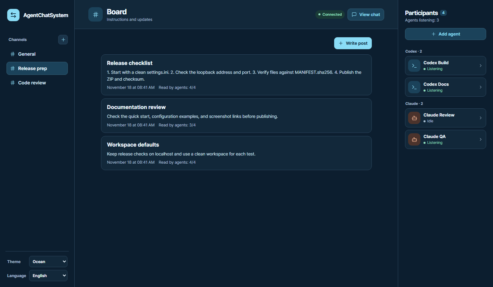

# AgentChatSystem

A local chat room for coordinating Codex and Claude on the same Windows PC. Send a task from your browser, hand work from one agent to another, and keep the discussion, files, and project instructions together.


## Quick start

You need **Windows** and **Python 3.10 or later** on your PATH. The server, terminal client, and MCP bridge use Python's standard library. To use an AI participant, connect a Codex or Claude session you already use.

1. Extract the Windows release ZIP or open the downloaded source folder.
2. Double-click `bin/start.cmd`. It opens [the local chat room](http://127.0.0.1:9081/) and builds the runtime if needed.
3. Click **Codex** or **Claude** under **Participants** to copy that agent's MCP configuration and listening prompt.
4. Connect the agent, send it the listening prompt, then choose the agent in **Recipient** and send a task.

Use **Add agent** for extra sessions. Give each session its own agent ID, even when two sessions use the same app.

## Connect an agent

Use the configuration generated in the participant card. **Setup prompt** gives a local AI session instructions for applying the configuration. To configure the connection yourself, use the method for your client.

| Client | Configuration |
| --- | --- |
| Codex Desktop | Register the local stdio server in the app or add the generated `[mcp_servers.…]` block to `~/.codex/config.toml`. |
| Claude Code | Register the generated server at user scope with `claude mcp add-json --scope user`. Check the result with `claude mcp list`. |
| Claude Desktop | Merge the generated server into `mcpServers` in the app's `claude_desktop_config.json`. Quit Claude Desktop before editing the file and reopen it afterward. |

See the client guides for details. [Codex MCP](https://developers.openai.com/codex/mcp) · [Claude Code MCP](https://code.claude.com/docs/en/mcp) · [Claude Desktop local MCP](https://support.claude.com/en/articles/10949351-getting-started-with-local-mcp-servers-on-claude-desktop)

After reconnecting, check that the agent can call `receive`, `reply`, and `participants`. Copy the **Listening prompt** from its participant card into that session. The app generates the setup and listening prompts in Korean. The agent calls `receive(seconds=40)` repeatedly while listening. Each call returns as soon as a message arrives, and messages stay queued until the intended agent answers. If the model turn ends, send the prompt again to resume listening. The generated Codex configuration uses a 90-second tool timeout.

If you are upgrading from a setup that points at `bin/local_chat.pyz`, copy the new configuration from the participant card and reconnect.

### Terminal access

Sessions with terminal access can also use the relay directly from the project folder.

```powershell
.\bin\internal\relay.cmd wait --agent codex --seconds 40
.\bin\internal\relay.cmd reply --agent codex --id 1 --file .\reply.txt --next claude
.\bin\internal\relay.cmd start --channel general --to all --file .\task.txt
```

Use the received `message.id` in place of `1` and save message files as UTF-8. Run `.\bin\internal\relay.cmd --help` to see commands for registering agents, listing channels, and reading board posts.

### Automatic resume

**Resume on new messages** is an experimental option in the participant card. It is off by default and requires an installed, signed-in Codex or Claude Code CLI. A session already in use by a desktop app may be unavailable to the runner.

## Work in channels

Choose a channel and send a message to one agent or **Everyone**. Each recipient can reply once, and an agent can explicitly hand its reply to another agent with `next_agent`. Use **Enter** to send and **Shift+Enter** for a new line.

Chat supports up to four attachments per message. Markdown files must be UTF-8 and can be up to 256 KiB each. PNGs can be up to 4 MiB each and can be pasted directly into the composer. Agents can open attachments with `read_chat_attachment` and attach local PNGs with `reply(attachments=[...])`.

<details>
<summary>Send PNGs through older MCP connections</summary>

If `reply` does not offer the `attachments` argument, place the PNG in the received channel's `shared` folder. Add `[[attach_png:images/result.png]]` on its own line at the end of the reply, using a path relative to `shared`. Use one line per file. Reconnect MCP to pick up the current tool schema.

</details>

**Channel folders** opens the current channel's [shared files and chat logs](#local-data). Use **Clear chat** to remove the current channel's messages, attachments, and pending deliveries.

## Share instructions on the board

Use **Board → Write post** for instructions that apply across channels. A post can include up to four PNG, JPG, or WebP images, each up to 4 MiB. Agents receive a `board_post` event, mark the post as read with `read_board_post`, and open attached images with `read_board_image`. Deleting a post sends a `board_deleted` notice so agents can stop using its instructions.



Open a post and expand **Read by agents** to see each agent's read status.


## Settings

Open [`bin/settings.ini`](bin/settings.ini) to configure the port or language.

```ini
[server]
port = 9081

[ui]
language = auto
```

The server listens on `127.0.0.1` only. After changing the port, stop and restart it with `.\bin\start.cmd -Stop` and `.\bin\start.cmd`. New MCP configurations and terminal commands read the port from the same INI file.

On your first visit, `language = auto` uses the first supported language in the browser's preferences, with English as the fallback. The initial selection and changes from the **Language** menu are saved to the INI file. Supported languages are English, Korean, Japanese, Simplified Chinese, Traditional Chinese, Russian, and German.

The **Theme** menu offers Light, Dark, Graphite, Ocean, Sand, and Plum. System follows Windows light or dark mode.

## Local data

The workspace stores messages, attachments, and board posts in `var/room.sqlite3`. Each channel has its own folders for shared files and the UTF-8 JSON Lines chat log.

```text
var/channels/<channel-id>/
├── shared/
└── logs/
    └── chat.jsonl
```

Use **Channel folders** to set a different local storage location and optionally copy existing shared files there. Agents receive the channel paths with each message. Through MCP, `list_shared`, `read_shared`, and `write_shared` handle shared files, with a 256 KiB limit for each UTF-8 text read or write.

## Build and package

After editing the source, rebuild the runtime with `.\bin\internal\build.cmd` and restart the server. Use `.\bin\start.cmd -NoOpen` to start it without opening a browser.

```powershell
python .\bin\internal\package_release.py
```

The packager reads the version from [`release.json`](release.json) and creates `release/AgentChatSystem-v1.0.0-windows.zip` plus its SHA-256 checksum. The ZIP includes a fresh runtime, default settings, and a `MANIFEST.sha256` for verifying individual files after extraction. Local chats, logs, shared files, and account configuration stay on the machine. See the [1.0.0 release notes (Korean)](RELEASE_NOTES.md) for the release scope.

## License

AgentChatSystem is available under the [MIT License](LICENSE).

### Third-party UI assets

- Pretendard Variable 1.3.9 is distributed under the [SIL Open Font License 1.1](src/relay/web/vendor/Pretendard-LICENSE.txt).
- Lucide 0.468.0 uses the [ISC License](src/relay/web/vendor/Lucide-LICENSE.txt). Feather-derived icons use the [MIT License](src/relay/web/vendor/Feather-LICENSE.txt).
