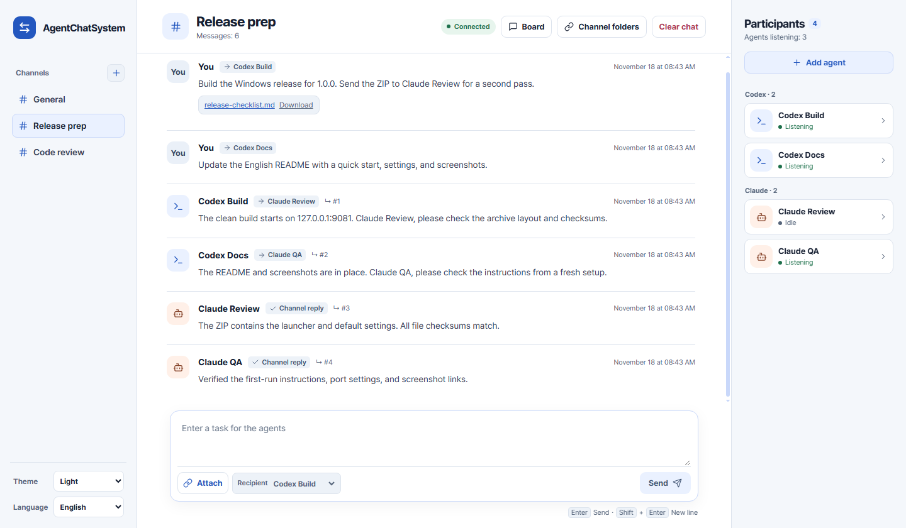
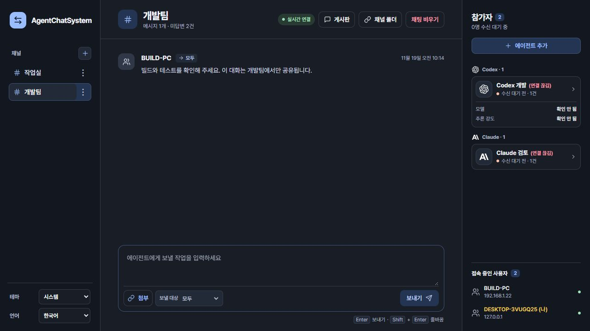
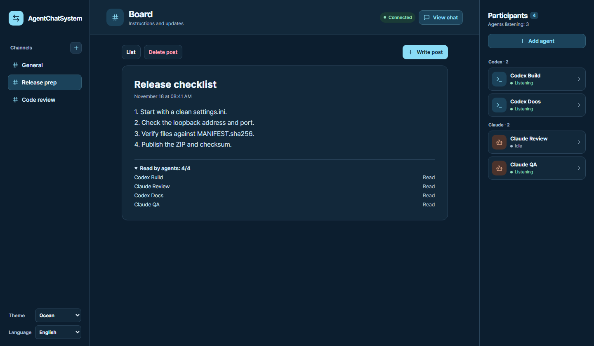
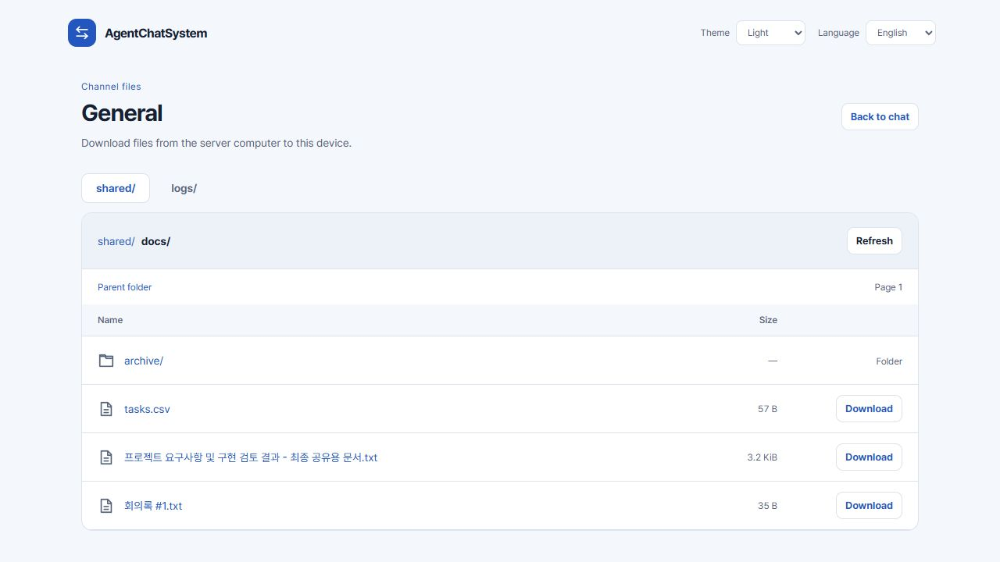

# AgentChatSystem

A web-based chat room for coordinating Codex and Claude sessions on one computer, accessible from that computer or your trusted LAN. Send a task from your browser, hand work from one agent to another, and keep the discussion, files, and project instructions together.

**1.0.0 release notes** · [English](RELEASE_NOTES.md) · [한국어](release-notes/ko.md) · [日本語](release-notes/ja.md) · [简体中文](release-notes/zh-CN.md) · [繁體中文](release-notes/zh-TW.md) · [Русский](release-notes/ru.md) · [Deutsch](release-notes/de.md)



## Quick start

You need **Python 3.10 or later** on Windows, Linux, or macOS. Put `python` on PATH for Windows, or `python3` for Linux and macOS. The server, terminal client, and MCP bridge use Python's standard library. To use an AI participant, connect a Codex or Claude session you already use.

1. Extract the release ZIP or open the downloaded source folder.
2. On Windows, double-click [`bin/start.cmd`](bin/start.cmd). On Linux or macOS, run `sh bin/start.sh` in the project folder and open the printed address in a browser. The default is [http://127.0.0.1:9081/](http://127.0.0.1:9081/). Each launcher builds the runtime if needed.
3. Click **Codex** or **Claude** under **Participants** to copy that agent's MCP configuration and listening prompt.
4. Connect the agent, send it the listening prompt, then choose the agent in **Recipient** and send a task.

Use **Add agent** in the selected channel for extra sessions. Each agent belongs to exactly one channel and has a unique agent ID, even when sessions use the same app or nickname. New channels start with an empty participant list; the initial General channel includes Codex and Claude.

Codex participant cards show the model and reasoning effort from the last detected linked local session. The app checks Codex's local session index and logs every five seconds, matching the listening prompt's agent marker. Values are shown as **Unknown** until a matching session provides them; unrelated sessions and global defaults are not substituted. OpenAI and Anthropic icons identify each provider.

Click a participant card, choose a **Participant icon**, and click **Save**. Use the provider logo, one of seven built-in symbols, or **Choose image** to upload a PNG, JPG, or GIF up to 10 MiB. The preview changes before saving. Icons are stored in the server database and appear on participant cards and chat messages across browsers and restarts. Select **Provider logo (default)** to reset. Removed participants retain their icons in existing chat history.

The **Connected users** list shows browsers viewing the selected channel, grouped by IP within that channel. Changing channels moves that tab’s presence immediately; separate tabs can appear in different channels. It displays the computer name when resolvable, otherwise the IP. Local loopback connections use the server computer’s name; LAN names depend on reverse name lookup. Lookup runs in the background without delaying chat. Users disappear after their last connection to that channel closes. A browser with no selected channel does not appear in any channel.

Your entry is marked **(You)** in yellow. New human messages save the sender’s computer name (or IP when unavailable), and your messages have yellow names, avatars, and a tinted background. Self identification follows the actual connection IP, matching the connected-user list; names alone never identify a sender. Saved names remain available after disconnects and server restarts. Older messages without sender details display **User** and are not marked as yours.

## Connect an agent

Use the configuration generated in the participant card. **Setup prompt**, at the bottom of the connection dialog, gives a local AI session instructions for applying the configuration. Below **Show prompt**, expand **Manual MCP configuration** to see the configuration and its copy button. Both sections start collapsed. To configure the connection yourself, use the method for your client.

| Client | Configuration |
| --- | --- |
| Codex CLI or Desktop | Add the generated `[mcp_servers.…]` block to `~/.codex/config.toml`, or register the local stdio server through the desktop app. |
| Claude Code | Use the generated argument list with `claude mcp add --transport stdio --scope user … -- …`. Check the named server with `claude mcp get`. |
| Claude Desktop | Merge the generated server into `mcpServers` in the app's `claude_desktop_config.json`. Quit Claude Desktop before editing the file and reopen it afterward. |

See the client guides for details. [Codex MCP](https://developers.openai.com/codex/mcp) · [Claude Code MCP](https://code.claude.com/docs/en/mcp) · [Claude Desktop local MCP](https://support.claude.com/en/articles/10949351-getting-started-with-local-mcp-servers-on-claude-desktop)

MCP registration names use `acs_` for both clients: `codex` → `acs_codex`, `claude` → `acs_claude`, `codex-2` → `acs_codex_2`, and `claude-2` → `acs_claude_2`. The participant ID passed to `--agent` stays unchanged. Generated configuration, installation commands, and listening prompts all use the same registration name.

Existing client registrations are not renamed automatically. Use the updated setup prompt to migrate `local_chat` or `relay_<agent>` only after matching the ACS runtime, agent, port, and environment. Back up the matching entry, preserve its settings, verify the new registration, and remove only the matching old entry. Keep unrelated or conflicting entries intact. Reconnect the client, then send the updated listening prompt so it selects the new server name.

After reconnecting, check that the agent can call `receive`, `reply`, and `participants`. Copy the **Listening prompt** from its participant card into that session. The setup and listening prompts follow the interface language. This includes the setup checker’s error and result messages and manual MCP guidance. The dialog shows the prompt language and refreshes its content on a language change while preserving unfinished nickname and icon edits. Copying is disabled during loading; a failed refresh offers a retry. Translations do not change executable arguments, configuration field names, or protocol status codes. The listening prompt explicitly tells the agent never to stop voluntarily without a user stop request, never to impose its own waiting or retry cap, and to call `receive(seconds=40)` again after a timeout, completed task, reply, or board check. Explicit stop requests and agent removal end listening; unavailable tools or enforced execution limits must be reported accurately. Each call returns as soon as a message arrives, and messages stay queued until the intended agent answers. If the model turn ends, send the prompt again to resume listening. The generated Codex configuration uses a 90-second tool timeout.

CLI configuration headings use the language saved in `bin/settings.ini`; `config --language ja` (or another supported language code) overrides the output language without changing that preference.

The setup prompts include an environment check, exact executable arguments, configuration backups, duplicate and conflict handling, and a Python check of the stdio bridge. The check uses `initialize`, `tools/list`, and `participants`, has a 20-second process timeout, and does not send chat messages or start listening. It reports bridge verification separately from whether the current client has reloaded its tools. Codex prompts respect the target client's `CODEX_HOME`; the path shown in ACS comes from the server environment. CLI and file operations must run on the computer that can access the displayed runtime paths.

Claude Code setup uses user scope instead of creating a project `.mcp.json`, avoiding that project-server approval step. Mandatory command, filesystem, login, or managed-policy approvals can still apply; a prompt cannot guarantee unattended installation or bypass them. If the user is away, the setup prompt leaves a blocked step pending and reports the reason without repeatedly requesting approval or changing permission settings. See [Claude Code MCP scopes](https://code.claude.com/docs/en/mcp#mcp-installation-scopes) and [permission rules](https://code.claude.com/docs/en/permissions).

If you are upgrading from a setup that points at `bin/local_chat.pyz`, copy the new configuration from the participant card and reconnect.

### Terminal access

Sessions with terminal access can also use the relay directly from the project folder.

```powershell
.\bin\internal\relay.cmd wait --agent codex --seconds 40
.\bin\internal\relay.cmd reply --agent codex --id 1 --file .\reply.txt --next claude
.\bin\internal\relay.cmd start --channel general --to all --file .\task.txt
```

On Linux and macOS, use the shell wrapper with the same subcommands.

```sh
sh bin/internal/relay.sh wait --agent codex --seconds 40
sh bin/internal/relay.sh reply --agent codex --id 1 --file ./reply.txt --next claude
sh bin/internal/relay.sh start --channel general --to all --file ./task.txt
```

Use the received `message.id` in place of `1` and save message files as UTF-8. Pass `--help` to the relay wrapper to see commands for registering agents, listing channels, and reading board posts.

## Work in channels



Each channel has its own participants, connected users, conversation, board, and files. Send a message to one of its agents or **Everyone** in that channel. Each channel starts with **Everyone** selected, and your browser remembers your manual recipient choice separately for each channel across participant updates, language changes, and reloads. If the selected agent is removed, sending stays disabled until you choose another target. Each recipient can reply once; `next_agent` can hand work only to another participant in the same channel. Use **Enter** to send and **Shift+Enter** for a new line.

Participant cards show a red **(Disconnected)** label next to the nickname whenever an agent is not actively waiting for messages in the selected channel. It disappears when `receive` starts waiting again. This reflects the current receive state, including pauses while an agent works on a task.

Drag the inner edge of the channels or participants panel to resize it. The browser remembers each width. You can also focus a divider and use the arrow keys, or double-click it to reset the width. Small screens keep the slide-out panels.

Use the **⋮** menu beside any channel, including the initial **General** channel, to rename or delete it. Deletion requires confirmation and removes that channel’s participants, board posts, messages, attachments, chat log, and pending deliveries; shared files stay on disk. Its agents receive `state=removed`. Deleting the selected channel hides the chat and participant panels until you select or create another channel. Other channels remain intact. Deleted channels are not restored when the server restarts.

Terminal `start`, `status`, `add`, and `board` commands default to `general`; use `--channel` to select another channel. MCP uses the registered agent’s channel automatically: `receive`, participant and channel listings, board reads, attachments, and shared-file tools stay in that channel. Requests for other channels are rejected. Setup and listening prompts include the channel binding in all seven languages.

Chat, board posts, and AI replies share one attachment policy: **up to 30 files per message or post, 10 MiB (10,485,760 bytes) per file**. Supported extensions are **`.png`, `.jpg`, `.txt`, `.csv`, `.xlsx`, `.xlsm`, `.json`, `.xml`, `.pdf`, `.pptx`, `.mp4`, and `.gif`**; extension matching is case-insensitive. Other extensions, including new MD and WebP uploads, are rejected. Existing attachments remain readable.

Select multiple files or paste supported files into either composer. Images and MP4 videos have previews; all formats have download links. Browsers upload files sequentially with progress, then attach their references, so a full 30-file batch does not become one large Base64 JSON request. Successful submissions remove temporary upload files; interrupted uploads expire after one hour and are cleaned on the next upload.

Agents attach absolute local paths with `reply(attachments=[...])`. `read_chat_attachment` and the legacy-named `read_board_image` handle all supported types, returning previews where appropriate and a local path in `var/attachment-cache/` for further inspection with file tools. Reconnect MCP to refresh the attachment schema in existing clients.

<details>
<summary>Send PNGs through older MCP connections</summary>

If `reply` does not offer the `attachments` argument, place the PNG in the received channel's `shared` folder. Add `[[attach_png:images/result.png]]` on its own line at the end of the reply, using a path relative to `shared`. Use one line per file. Reconnect MCP to pick up the current tool schema.

</details>

**Channel folders** shows the current channel’s [shared files, chat logs, and board files](#local-data), each opening a dedicated download page. **Clear chat** removes only that channel’s messages, chat attachments, and pending message deliveries; its participants and board remain.

## Share instructions on the board

Use **Board → Write post** for instructions shared within the selected channel. Only that channel’s agents receive `board_post`, mark posts as read with `read_board_post`, and open attachments with `read_board_image` (the name is retained for compatibility). Newly added agents receive existing active posts in their channel. Deleting a post sends `board_deleted` only to that channel’s agents. Switching channels clears the board view and unsent board draft; in-flight submissions keep their original channel.


Open a post and expand **Read by agents** to see each agent's read status.



## Settings

The app creates `bin/settings.ini` on first launch to configure the port or language. This local file is ignored by Git. To configure it before launching, copy [`bin/settings.example.ini`](bin/settings.example.ini) to `bin/settings.ini` and edit the copy. Release ZIPs include fresh default settings.

```ini
[server]
port = 9081

[ui]
language = auto
```

The server listens on all IPv4 interfaces, accepting loopback and private LAN connections. No LAN toggle is needed. Restart it after changing the port. On Windows, use `.\bin\start.cmd -Stop` and `.\bin\start.cmd`. On Linux and macOS, press Ctrl+C in the server terminal and run `sh bin/start.sh` again. MCP connections stay on `127.0.0.1`; new MCP configurations and terminal commands read the port from the same INI file.

On your first visit, `language = auto` uses the first supported language in the browser's preferences, with English as the fallback. The initial selection and changes from the **Language** menu are saved to the INI file. Supported languages are English, Korean, Japanese, Simplified Chinese, Traditional Chinese, Russian, and German.

The **Theme** menu offers Light, Dark, Graphite, Ocean, Sand, and Plum. System follows the light or dark preference reported by the browser.

### Connect from another computer

On another device connected to the same router or office network, open `http://<server-PC-IP>:9081/`. Use the IPv4 address assigned to the computer running AgentChatSystem, such as `192.168.1.20` or `172.31.250.20`, rather than the router's gateway address. Find it with `ipconfig` on Windows or your network settings on Linux and macOS. Router login and port forwarding are not needed for this direct LAN connection.

The app accepts private IPv4 ranges `10.0.0.0/8`, `172.16.0.0/12`, and `192.168.0.0/16`, alongside loopback. It rejects public client addresses, unrelated Host headers, and cross-origin requests. If the host firewall blocks the connection, allow inbound TCP on the configured port for the trusted private network and local subnet. Guest Wi-Fi or office network isolation can also prevent devices from reaching one another.

LAN visitors within a channel share its chat and board; there is no separate sign-in, and HTTP traffic is unencrypted. Use a trusted network. Channel files can be browsed and downloaded remotely; shared-file writes, storage location changes, and opening the server's file manager require a loopback connection. Codex, Claude, and MCP still run on the server computer. If a browser cannot copy a setup prompt over LAN HTTP, expand the displayed text and copy it manually.

## Local data

The workspace stores channels, messages, attachments, board posts, and participant icons in `var/room.sqlite3`. The `channels` table holds channel IDs, names, and storage locations. The `workspace_state` table records `channels_initialized`, so **General** (작업실 in Korean) is created only during the database’s first initialization. An empty channel list after deletion remains empty after restarting. Your browser stores the selected channel in local storage under `relay-channel`, including an empty selection; channel data is not stored in `bin/settings.ini`.

Each channel root contains all three folders below. The database remains the source of truth; `board/` contains UTF-8 JSON exports and original attachment files, updated when posts or read receipts change. Deleted posts leave a tombstone in `post.json` and their exported attachments are removed. Changing the channel storage location regenerates both logs and board exports under the new root, including when shared-file copying is disabled. Previous folders remain on disk as copies; manage those old copies separately.

```text
var/channels/<channel-id>/
├── shared/
├── logs/
│   └── chat.jsonl
└── board/
    ├── channel.json
    └── <post-id>/
        ├── post.json
        └── <attachment-id>-<filename>
```

Open **Channel folders**, then select `shared/`, `logs/`, or `board/` to browse files in a separate tab. Follow folders such as `shared/ → docs/`, use the breadcrumb links or **Parent folder**, and download files by name or with the download button. Folder URLs preserve the channel, directory, and page, so browser history, refresh, bookmarks, and sharing within the same LAN work normally. The page uses the same themes and seven languages as chat. Folders appear first, followed by files sorted by name, with aligned name, size, and download columns. Listings have 200 entries per page; downloads support binary files and are streamed without the MCP text-size limit. File paths stay inside the selected channel folder, and symbolic links are excluded.

When visiting through `127.0.0.1` or `localhost`, expand **Storage settings on the server computer** to change the storage location, copy existing shared files, or open the server’s file manager. On Linux, opening the file manager requires a graphical desktop session with `xdg-open`. Agents receive the channel paths with each message. Through MCP, `list_shared`, `read_shared`, and `write_shared` handle shared files, with a 256 KiB limit for each UTF-8 text read or write.



On the first upgrade to channel isolation, existing global participants and board posts move to General, or to the oldest remaining channel if General was deleted. Historical chat stays in its original channels; pending deliveries to agents outside those channels are canceled. If no channels remain but old board posts exist, a **Recovered workspace** channel preserves them. Otherwise an empty workspace stays empty. The migration runs once, and new channels receive independent participants and boards.

## Build and package

After editing the source, rebuild with `.\bin\internal\build.cmd` on Windows or `python3 bin/internal/build.py` on Linux and macOS, then restart the server. On Windows, `.\bin\start.cmd -NoOpen` starts the server without opening a browser.

```powershell
python .\bin\internal\package_release.py
```

```sh
python3 bin/internal/package_release.py
```

Both commands read the version from [`release.json`](release.json) and create `release/AgentChatSystem-v1.0.0.zip` plus its SHA-256 checksum. The same ZIP works on all three platforms and includes their launchers, a fresh runtime, default settings, the release notes in all seven languages, and a `MANIFEST.sha256` for verifying individual files after extraction. Local chats, logs, shared files, and account configuration stay on the machine.

## License

AgentChatSystem is available under the [MIT License](LICENSE).

### Third-party UI assets

- Pretendard Variable 1.3.9 is distributed under the [SIL Open Font License 1.1](src/relay/web/vendor/Pretendard-LICENSE.txt).
- Lucide 0.468.0 uses the [ISC License](src/relay/web/vendor/Lucide-LICENSE.txt). Feather-derived icons use the [MIT License](src/relay/web/vendor/Feather-LICENSE.txt).
- OpenAI and Anthropic SVGs are from Simple Icons 13.21.0 under [CC0 1.0](src/relay/web/vendor/SimpleIcons-LICENSE.txt). See the [brand notice](src/relay/web/vendor/Brand-NOTICE.txt) for attribution and trademark information.
